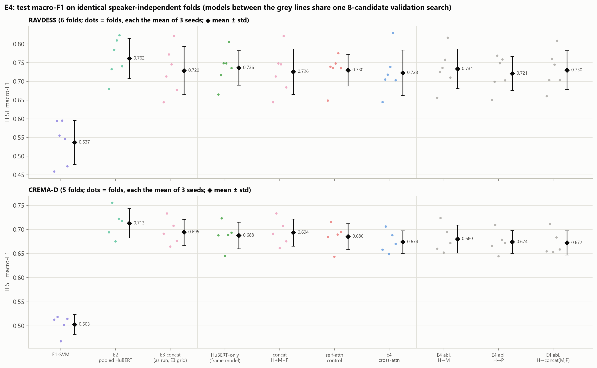
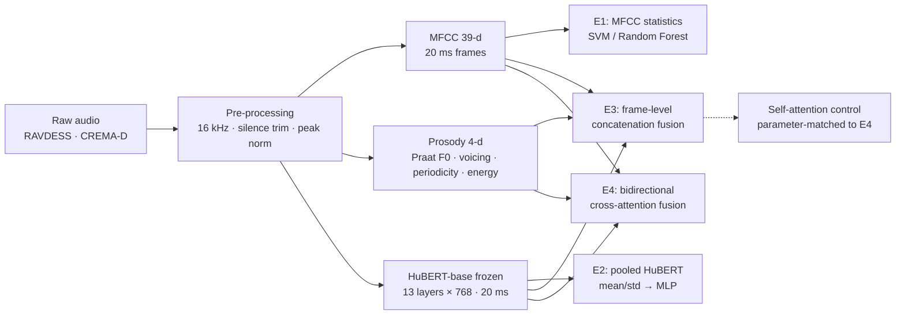
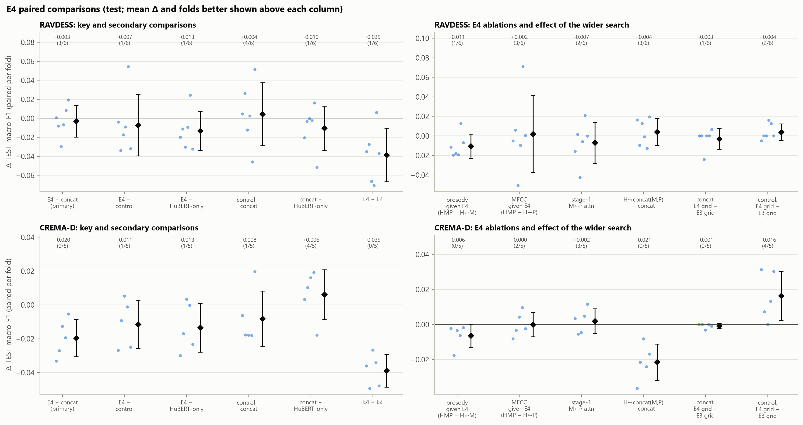
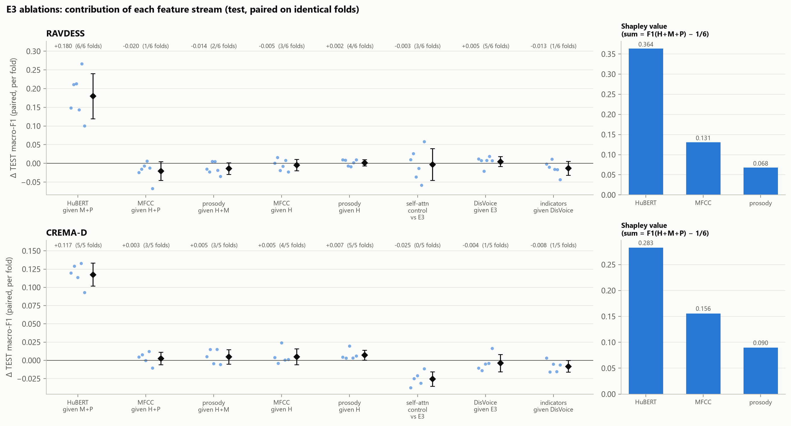
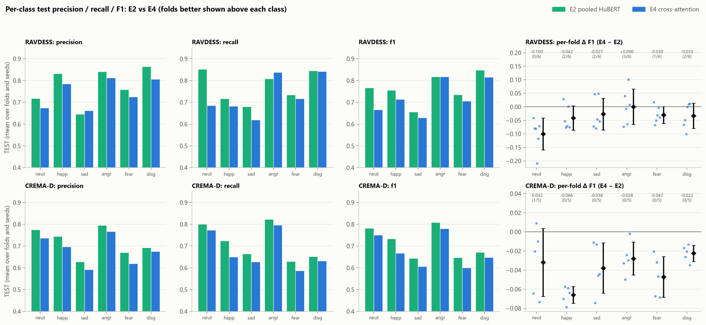
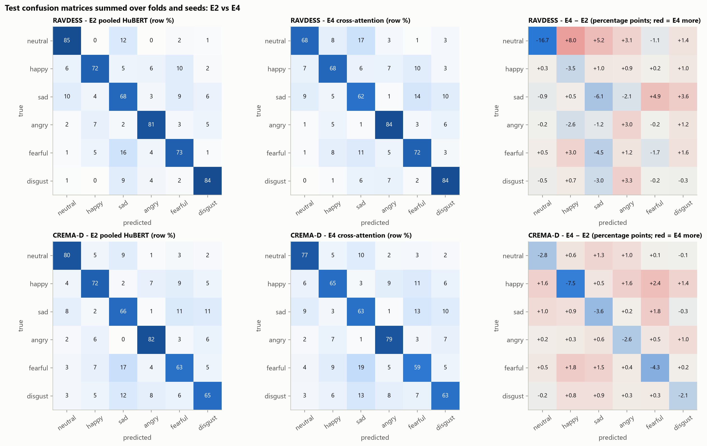
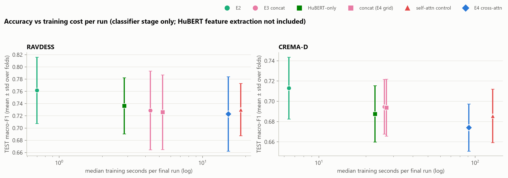

<div align="center">

# Revisiting Multi-Feature Fusion for Speech Emotion Recognition

### A controlled, speaker-independent evaluation of HuBERT, MFCC, prosody and cross-attention


</div>

> **Research question.** Does multi-feature fusion, and cross-attention in particular, improve on pooled pre-trained
> HuBERT representations for **speaker-independent** speech emotion recognition (SER)?
>
> **Short answer (on two acted English corpora).** No.
> - **A small MLP on time-pooled frozen HuBERT features (E2) is the strongest model:** 0.762 / 0.713 macro-F1.
> - **Bidirectional cross-attention fusion (E4) is the most sophisticated model, and among the weakest HuBERT
>   models:** 0.723 / 0.674. It does not consistently beat plain concatenation, a parameter-matched self-attention
>   control, or HuBERT alone.

The project is inspired by the HuMP-CAT reference paper (Zhao et al., [arXiv:2501.10408](https://arxiv.org/abs/2501.10408)).
It is **not a reproduction** of that paper. We do not evaluate cross-lingually, and its reported numbers are never mixed
with ours.

---

## Contents
- [Key results](#key-results)
- [Experiments](#experiments)
- [Evaluation protocol](#evaluation-protocol)
- [Detailed findings](#detailed-findings)
- [Reproducing the study](#reproducing-the-study)
- [Repository layout](#repository-layout)
- [Limitations](#limitations)
- [References and data licences](#references-and-data-licences)

---

## Key results

Test macro-F1 is the mean ± standard deviation over speaker-independent folds; each fold is the mean of 3 seeds. Every
number below is read from `results/`, and the figures are recomputed three ways in
`results/final_analysis/final_analysis.json`.

| Model | Input → fusion | Trainable params | **RAVDESS** (6 folds) | **CREMA-D** (5 folds) |
|---|---|---:|:---:|:---:|
| E1 SVM | MFCC statistics | (SVM) | 0.537 ± 0.059 | 0.503 ± 0.021 |
| **E2 pooled HuBERT** | time-pooled HuBERT → MLP | 198 k – 1.58 M | **0.762 ± 0.054** | **0.713 ± 0.030** |
| E3 concatenation | HuBERT + MFCC + prosody frames → concat | 221,574 | 0.729 ± 0.064 | 0.695 ± 0.027 |
| HuBERT-only frame model | HuBERT frames | 182,534 | 0.736 ± 0.046 | 0.688 ± 0.028 |
| Self-attention control | concat + 4 self-attention blocks | 751,750 | 0.730 ± 0.043 | 0.686 ± 0.026 |
| **E4 cross-attention** | 2-stage bidirectional cross-attention | **769,286** | 0.723 ± 0.061 | 0.674 ± 0.023 |

*The HuBERT-only, self-attention control and E4 rows use the same extended 8-candidate validation search. Chance level
is 0.167.*

- 📈 **HuBERT dominates.**
  - E2 beats the MFCC + SVM baseline by +0.225 and +0.210, in every fold.
  - E2 is the best of the 7 main models in **9 of 11 folds**.
- 🔁 **Fusion does not help.**
  - The pre-registered verdict for E4 against concatenation, the control and HuBERT-only is
    **"no consistent improvement"** on both datasets.
  - On CREMA-D, cross-attention is below concatenation in **all 5 folds** (−0.020).
- 🧩 **MFCC and prosody are redundant once HuBERT is present.**
  - Removing HuBERT costs 0.18 / 0.12 macro-F1.
  - Adding MFCC + prosody to HuBERT changes the score by −0.018 / +0.010.
- ⚖️ **The strongest model is not the most sophisticated one.** E4 needs 14–22× E2's training time per run and has the
  largest seed variance.

<p align="center">
  <br>
  <em>Test macro-F1 per fold (dots) with mean ± std (◆) on identical speaker-independent folds.</em>
</p>

---

## Experiments



| ID | Model | What it tests |
|---|---|---|
| **E1** | MFCC functionals (mean / std / percentiles) with an RBF-SVM or Random Forest | Classical baseline; checks the pipeline cheaply |
| **E2** | Frozen HuBERT, pooled over time ([mean ‖ std]); MLP head. Layer, pooling and head chosen on validation | How much a self-supervised representation adds |
| **E3** | Per-frame projection of HuBERT / MFCC / prosody to 128-d → concatenation → GELU → masked mean+std pooling → MLP. Ablations over every stream subset and DisVoice-103 | Whether hand-crafted streams add to HuBERT |
| **E4** | Stage 1: MFCC ↔ prosody cross-attention. Stage 2: HuBERT ↔ acoustic cross-attention (pre-LN, 4 heads). Pooling and head as E3 | Whether *interaction* between streams helps |
| Control | E3 plus 4 self-attention blocks, 751,750 params (−2.3% vs E4) | Separates "attention across streams" from "more attention capacity" |

> ⚠️ **Design note (E4).** Neither attention model uses positional encoding.
> - Cross-attention is therefore **content-based**: a frame cannot specifically attend to the time-aligned frame of
>   another stream.
> - The shared 20 ms grid is used only by the frame-wise fusion layers.
> - Results speak to content-based cross-attention, not to every possible cross-modal attention design.

---

## Evaluation protocol

Every number in this repository comes from the protocol below.

| Aspect | Setting |
|---|---|
| Corpora | **RAVDESS** speech: 24 actors, 1,056 recordings of 6 classes. **CREMA-D**: 91 actors, 7,442 indexed recordings. Both are acted English speech. |
| Classes | neutral, happy, sad, angry, fearful, disgust (RAVDESS calm and surprised excluded) |
| Splits | **Speaker-independent.** RAVDESS 6 folds × 16 / 4 / 4 speakers; CREMA-D 5 folds × 58 / 15 / 18 speakers. Split files are frozen and SHA-256-checked |
| Fitting | Scalers, imputation values and class weights are fitted on **training speakers only** |
| Model selection | **Validation macro-F1 only.** `selection.json` is written before any test prediction exists |
| Final runs | Seeds 0, 1, 2. Each checkpoint is saved, reloaded and used to predict the test speakers **once** |
| Metrics | Macro-F1 (primary), UA, accuracy, macro precision, per-class P/R/F1, confusion matrices |
| Statistics | Seeds averaged per fold; mean ± std over folds; paired per-fold Δ with fold win counts; exact sign-flip tests. No significance is claimed after correction (with 6 and 5 folds the smallest attainable p is 0.031 and 0.062) |

**Integrity controls.**
- Automated leakage audits: E2 28/28, E3 36/36 and E4 41/41 checks passed. Every checkpoint re-predicts its saved test
  predictions **exactly**.
- Label-permutation controls are at chance: 0.140–0.187 against a chance level of 0.167.
- NaN-poisoning unit tests prove that test frames never enter fitting or selection.

---

## Detailed findings

<details>
<summary><b>Paired comparisons for E4</b> (pre-registered decision rule)</summary>

| Δ test macro-F1 (folds better) | RAVDESS | CREMA-D | Verdict |
|---|---|---|---|
| E4 − concatenation | −0.003 (3/6) | −0.020 (**0/5**) | no consistent improvement |
| E4 − self-attention control | −0.007 (1/6) | −0.012 (1/5) | no consistent improvement |
| E4 − HuBERT-only | −0.013 (1/6) | −0.014 (1/5) | no consistent improvement |
| E4 − E2 | −0.039 (1/6) | −0.039 (0/5) | — |


</details>

<details>
<summary><b>Feature-stream contributions</b> (E3 ablations, Shapley values)</summary>

| Contribution (Δ test macro-F1) | RAVDESS | CREMA-D |
|---|---|---|
| HuBERT, given MFCC + prosody | **+0.180** (6/6) | **+0.117** (5/5) |
| MFCC + prosody, given HuBERT | −0.018 (0/6) | +0.010 (4/5) |
| DisVoice-103, added to E3 | +0.005 | −0.004 |
| Shapley value, HuBERT / MFCC / prosody | 0.364 / 0.131 / 0.068 | 0.283 / 0.156 / 0.090 |

MFCC and prosody complement each other *without* HuBERT, but are largely redundant *with* it. The Shapley values
average over coalitions that exclude HuBERT, so they are not "gain added to E3".


</details>

<details>
<summary><b>Per-class behaviour and confusions</b> (E2 vs E4)</summary>

- **RAVDESS.** The deficit is concentrated on *neutral* (F1 −0.100; recall 0.85 → 0.68). The HuBERT-only frame model
  shows almost the same loss (−0.096), so this is a frame-pipeline effect, not a fusion effect.
- **CREMA-D.** Every class drops. *Happy* drops most (−0.066) and is the class that cross-attention loses on in every
  comparison.
- **All models, including E1,** confuse the same cluster: fearful ↔ sad ↔ disgust, plus neutral → sad.



</details>

<details>
<summary><b>Computational cost</b> (classifier stage only; HuBERT feature extraction is shared and was not timed)</summary>

| Model | Params | Median training s/run (R / C) | Inference ms/recording | GPU peak MiB (R / C) |
|---|---:|---|---|---|
| E1 SVM (CPU) | — | 0.04 / 1.7 | 0.07 / 0.45 | — |
| E2 | 198 k – 1.58 M | 0.70 / 6.4 | 0.04 / 0.07 | 85 / 759 |
| HuBERT-only frame model | 182,534 | 2.8 / 22.9 | 0.05 | 316 / 1,613 |
| Concatenation | 221,574 | 5.3 / 27.0 | 0.06–0.07 | 316 / 1,614 |
| Self-attention control | 751,750 | 18.5 / 129.5 | 0.25–0.26 | 693 / 2,074 |
| E4 | 769,286 | 15.1 / 91.0 | 0.26–0.27 | 715 / 2,098 |

R = RAVDESS, C = CREMA-D. CREMA-D frame-model GPU peaks include the 1.35 GB HuBERT layer held on the GPU.


</details>

<details>
<summary><b>Why does pooled HuBERT beat the frame-level models?</b> (open question)</summary>

**Measured.** On RAVDESS, E2 used the *same single layer* as the HuBERT-only frame model in every fold, and still won
in 6/6 folds.

**Candidate factors (untested hypotheses).** E2 and the frame models also differ in:
- multi-layer input (E2 used it on CREMA-D);
- the 128-d per-frame bottleneck with LayerNorm;
- gradient clipping;
- search breadth (39 vs 8 candidates);
- loss weighting.

A controlled one-factor study (the "G-study", `reports/stage5_models.md` §8) was designed. Its validation-only
reproduction gates passed, but it was **cancelled by scope decision and never run**. It is not part of the results.
</details>

---

## Reproducing the study

**Hardware used:** Windows 11, NVIDIA RTX 3050 Laptop (4 GB), 16 GB RAM, Python 3.12.

### 1. Environment
```powershell
python -m venv C:\SER_data\.venv
C:\SER_data\.venv\Scripts\python.exe -m pip install -r requirements.txt   # pinned versions, CUDA 12.6 wheels
C:\SER_data\.venv\Scripts\python.exe scripts\check_env.py
C:\SER_data\.venv\Scripts\python.exe scripts\check_hubert.py
```
Large artefacts (audio, feature caches (the CREMA-D HuBERT cache alone is 17.6 GB), checkpoints) live outside the
repository in
`C:\SER_data`. Set `$env:SER_DATA` to use another location (see `src/utils/paths.py`).

### 2. Data, splits and features
```powershell
$py = "C:\SER_data\.venv\Scripts\python.exe"
& $py scripts\download_datasets.py                                  # RAVDESS (Zenodo, MD5-verified) + CREMA-D
& $py scripts\stage2_prepare_data.py                                # index, decoding checks, statistics
& $py scripts\stage3_make_splits.py                                 # speaker-independent folds (already versioned in data/splits)
& $py scripts\stage4_extract_features.py --datasets RAVDESS CREMA-D # MFCC, Praat prosody, DisVoice-103, HuBERT (13 layers)
& $py scripts\stage4_validate_features.py --dataset RAVDESS         # feature validation (repeat for CREMA-D)
& $py scripts\stage5_audit_stage4.py                                # cache audit
```

### 3. Experiments (each run is resumable and writes its own JSON)
```powershell
& $py scripts\stage5_e1_run.py --datasets RAVDESS CREMA-D ; & $py scripts\stage5_e1_run.py --datasets RAVDESS CREMA-D --summarise
& $py scripts\stage5_e2_run.py --datasets RAVDESS CREMA-D ; & $py scripts\stage5_e2_run.py --datasets RAVDESS CREMA-D --summarise
& $py scripts\stage5_e3_run.py --datasets RAVDESS CREMA-D ; & $py scripts\stage5_e3_run.py --datasets RAVDESS CREMA-D --summarise
& $py scripts\stage5_e4_run.py --datasets RAVDESS --pilot --folds 0          # validation-only pilot (the full run refuses a changed config)
& $py scripts\stage5_e4_run.py --datasets RAVDESS ; & $py scripts\stage5_e4_run.py --datasets CREMA-D
& $py scripts\stage5_e4_run.py --datasets RAVDESS CREMA-D --summarise
```
On 16 GB machines, run CREMA-D in its own process. `scripts/run_e4_cremad_restart.ps1` wraps it with a RAM guard
(stop below 1 GB, no automatic restart).

### 4. Controls, audits, figures and the final analysis
```powershell
& $py scripts\stage5_e2_controls.py ; & $py scripts\stage5_e3_controls.py ; & $py scripts\stage5_e4_controls.py
& $py scripts\stage5_e2_audit.py    ; & $py scripts\stage5_e3_audit.py    ; & $py scripts\stage5_e4_audit.py
& $py scripts\stage5_e1_plots.py ; & $py scripts\stage5_e2_plots.py ; & $py scripts\stage5_e3_plots.py ; & $py scripts\stage5_e4_plots.py
& $py scripts\stage5_final_analysis.py
& $py -m pytest                                                     # 159 tests
```

| Approximate run time (RTX 3050) | RAVDESS | CREMA-D |
|---|---|---|
| E1 | seconds | minutes |
| E2 | minutes | about 20 min |
| E3 | about 0.5 h | about 2 h |
| E4 (4 tuned models + 3 ablations) | about 1 h | about 5 h |

---

## Repository layout

```
configs/        experiment configurations (frozen; each runner checks its config before running)
data/metadata/  file index and verified dataset statistics
data/splits/    speaker-independent fold definitions (SHA-256-checked)
src/
  preprocessing/  dataset index, audio checks, splits
  features/       MFCC, Praat prosody, DisVoice-103, HuBERT extraction, feature store
  models/         E1 classical, E2 pooled head, E3 fusion, attention blocks, E4 cross-attention
  training/       leakage-safe fold access, preprocessing, deterministic trainers
  evaluation/     metrics
scripts/        one runnable entry point per stage, plus controls, audits, plots and the final analysis
tests/          pytest suite (159 tests: leakage isolation, masking, determinism, parameter matching, ...)
results/E1..E4  per-run JSON, summaries, audits, permutation controls
results/final_analysis/   cross-experiment verification and analysis
plots/          all figures
reports/        stage5_models.md (full report), feature_extraction.md, research_paper_outline.md
experiments/    LOG.md (central experiment log of every decision, run and interruption)
```

📄 **Full report:** [`reports/stage5_models.md`](reports/stage5_models.md). It covers the methodology, every table,
the ablations, the statistical caveats and the final comparative analysis (§7).
📓 **Decision log:** [`experiments/LOG.md`](experiments/LOG.md).

---

## Limitations

- **Data.** Two **acted English** corpora; RAVDESS uses only two sentences. There is no cross-corpus or cross-lingual
  evaluation.
- **Statistical power.**
  - With 6 and 5 folds, fold-level tests have low power.
  - Folds share training speakers, so they are not independent observations.
  - Consistency claims refer to fold counts, not significance.
- **Features.** One frozen HuBERT-base model; the frame-level models use one layer per fold.
- **Comparability of E2 and the frame models.** They differ in representation search, search breadth, clipping and loss
  weighting; see the open question above.
- **Tuning.**
  - Some learning-rate selections lie on the edge of the grid.
  - The ablations reuse the full model's hyper-parameters.
- **Attention design.** E4 has no positional encoding.
- **Timing scope.** Reported times cover the classifier stage only.

---

## References and data licences

- R. Zhao et al., *Leveraging Cross-Attention Transformer and Multi-Feature Fusion for Cross-Linguistic Speech Emotion
  Recognition*, arXiv:2501.10408, 2025. This is the reference paper; it is not reproduced here.
- W.-N. Hsu et al., *HuBERT: Self-Supervised Speech Representation Learning by Masked Prediction of Hidden Units*,
  IEEE/ACM TASLP, 2021. Model used: `facebook/hubert-base-ls960`.

| Dataset | Source | Licence |
|---|---|---|
| RAVDESS (speech) | Zenodo record 1188976 | CC BY-NC-SA 4.0 |
| CREMA-D | github.com/CheyneyComputerScience/CREMA-D | ODbL |

Datasets are **not** included in this repository. Download them with `scripts/download_datasets.py` and respect their
licences.

<sub>Course project by a team of two. If you use this code or these results, please cite this repository and the
original dataset and model papers.</sub>
